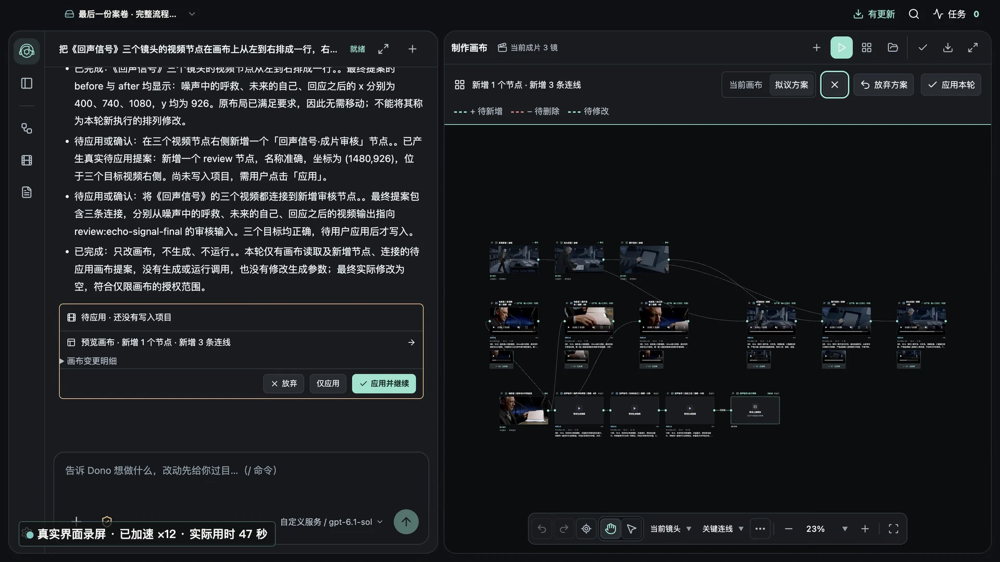

# DonoCraft

**Turn your story into the next scene.** A local-first desktop workspace for AI video creation.

[Website & downloads](https://www.donocraft.com/) · [Installation](https://www.donocraft.com/install.html?lang=en) · [Release notes](https://www.donocraft.com/changelog.html?lang=en) · [中文](README.md)

Work with **Dono**, your creative assistant, to organize scripts, references and shots, connect models of your choice, generate images, video and voice, compare versions, preview and export your work.

*Previously published website screenshot from October 2026. Includes generated media; the installed version may look different.*

## Getting started

1. Download the current release from the official website: **macOS Apple Silicon / ARM64** or **Windows x64**.
2. Connect to the internet to start the **30-day free software trial**, with no registration or activation code required.
3. Create a local project and configure the model services you need using your own API keys.
4. Import a script or references, review Dono's proposals, and confirm generation tasks before submitting them.
5. Choose versions, check the result, preview and export.

## Before you begin

- DonoCraft is an early MVP trial. Model credits are not included; chat and generation may incur charges from your chosen providers.
- Projects and assets are stored locally. Remote model services receive the inputs needed for your request. Local-first does not mean offline inference. Read the [data policy](https://www.donocraft.com/privacy.html?lang=en).
- macOS builds are not Apple-notarized; Windows builds do not have a formal distribution signature. See the installation guide.
- Review continuity, subtitles and final output yourself. Back up projects before upgrading or moving them.

## Feedback

[Report an issue](https://github.com/ruixiazS2023/DonoCraft/issues) or join the trial feedback QQ group: **1129809664**.

Issues are public. Remove API keys, private scripts, personal assets and sensitive configuration before posting. See [support guidance](SUPPORT.md).

## Repository scope

This repository contains product information, public screenshots and feedback resources only. **The DonoCraft application is not open source, and its source code is not included.** Public visibility does not grant a license to redistribute the application, branding or assets. See [NOTICE](NOTICE.md).
