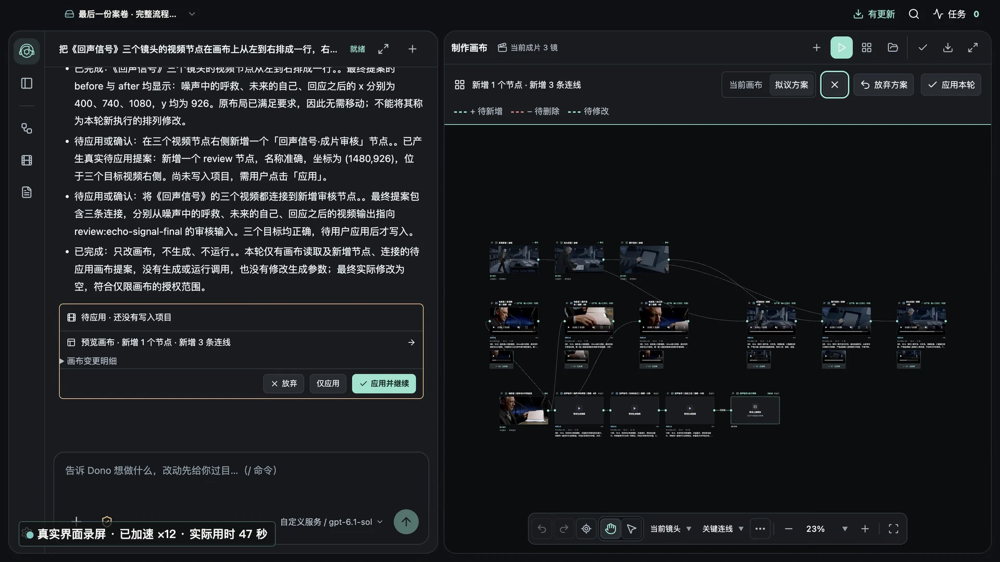
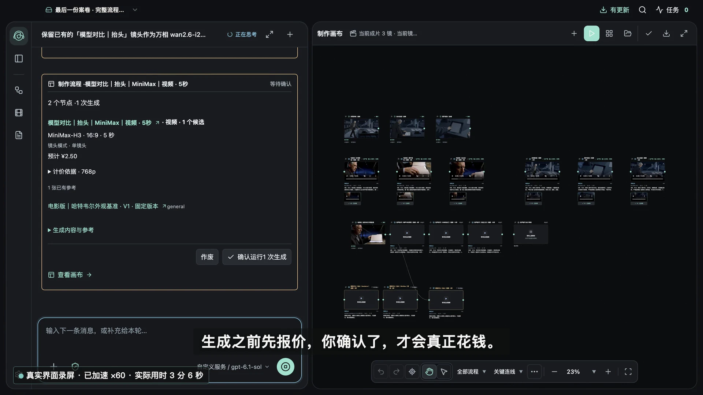

<h1 align="center">DonoCraft</h1>

<strong>把故事，变成下一幕。</strong> 本地优先的 AI 视频制作工作台

<a href="https://www.donocraft.com/">官网与下载</a> · <a href="https://www.donocraft.com/install.html">安装说明</a> · <a href="https://www.donocraft.com/changelog.html">更新日志</a> · <a href="https://github.com/ruixiazS2023/DonoCraft/issues">问题反馈</a> · <a href="README.en.md">English</a>

DonoCraft 面向希望把故事制作成视频的桌面创作者。与创作搭档 **Dono** 对话，在同一个工作台整理剧本、素材与镜头，连接自己选择的模型生成画面、视频和配音，挑选版本、预览并导出成片。

**让更多有故事的人，能把故事拍出来。** 工具协助推进制作，故事怎么讲、最终采用哪一版，由创作者决定。

> 本仓库用于产品介绍、使用指引和公开反馈。DonoCraft 软件尚未开源，本仓库不提供应用源码、开发配置或模型密钥。

## 看看工作台

*官网已公开的中文界面截图，拍摄于 2026 年 10 月；含生成素材，界面以当前安装版本为准。*

## 可以做什么

| 环节 | 工作方式 |
| --- | --- |
| 剧本与素材 | 在本地项目整理剧本、角色、场景与参考素材 |
| Dono 与画布 | 用对话讨论制作目标，核对方案，在画布接手调整 |
| 镜头生成 | 按需连接图片、视频和配音模型，确认后提交生成 |
| 选版与检查 | 保留历史版本，挑选采用结果，进行基础裁切、连续预览和人工检查 |
| 成片与交付 | 组织镜头顺序，预览并导出成片及相关交付资料 |
| 本地项目 | 在电脑保存项目与素材，使用备份和恢复功能管理作品 |

*生成前核对输入与预估费用；预估费用不代替模型服务商的实际账单。*

## 下载与开始使用

访问 **[www.donocraft.com](https://www.donocraft.com/)** 获取当前已发布版本。下载以官网为准，本仓库不重复托管安装包。

- **macOS：** Apple Silicon / ARM64。
- **Windows：** x64 / 64 位。
- 当前提供桌面应用；没有 Linux 或 Intel Mac 安装包发布承诺。

1. 按照[安装说明](https://www.donocraft.com/install.html)安装对应平台版本。
2. 首次联网自动开通 **30 天免费软件试用**，无需注册或填写激活码。
3. 创建本地项目，配置自己需要的模型接口、模型名称与 API Key。
4. 导入剧本或素材，与 Dono 一起推进镜头制作；核对生成任务后再确认提交。
5. 挑选采用版本、检查镜头与声音，预览并导出。

## 使用前了解

- **早期试用：** 当前为 MVP 早期试用版本，优先修复问题、提升稳定性和日常使用体验。
- **模型费用：** 软件试用不包含模型额度；API Key 由用户自行配置，Dono 对话和媒体生成可能产生模型服务费用。
- **数据边界：** 项目与素材保存在本地。使用远程模型时，会向选定服务发送本次所需的提示词与相关素材；本地项目不等于离线模型推理。详见[隐私与数据说明](https://www.donocraft.com/privacy.html)。
- **安装提示：** macOS 当前尚未完成 Apple 公证，Windows 尚无正式发行签名。首次安装提示与处理方式请查看官网安装说明。
- **创作判断：** 连续性、字幕、画面质量与最终交付仍需人工检查；复杂剪辑、调色和混音可继续使用专业剪辑软件。
- **备份：** 升级或迁移前备份项目，不要同时用多个应用进程写入同一项目。

## 反馈与交流

- [提交使用问题](https://github.com/ruixiazS2023/DonoCraft/issues/new?template=bug_report.yml)
- [提出体验建议](https://github.com/ruixiazS2023/DonoCraft/issues/new?template=feedback.yml)
- **试用反馈 QQ 群：1129809664**

请提供软件版本、操作系统、复现步骤和脱敏截图。**不要公开 API Key、激活信息、私人剧本、个人素材、完整配置文件或未经检查的日志。** 本仓库的 Issue 对所有人公开，详情见[反馈说明](SUPPORT.md)。

## 关于本仓库

这里只维护 DonoCraft 的公开介绍与反馈资料。公开可见不代表软件开源，也不授予应用、商标或展示素材的再分发许可；引用或使用请见[使用声明](NOTICE.md)。
